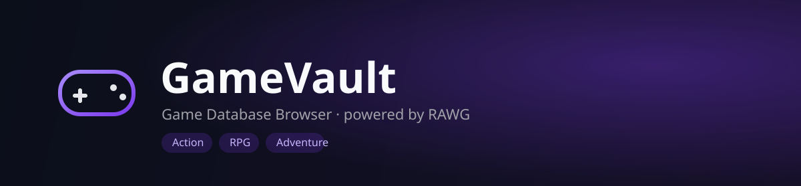

<div align="center">

[![CI][ci-img]][ci-url]
[![Stars][stars-img]][stars-url]
[![Forks][forks-img]][forks-url]

</div>

</br>



<div align="center">

# GameVault — **Game Database Browser**

Full-stack **game database browser** built on the **RAWG API**

search and browse games, view details,

and keep a personal **Wishlist / Playing / Completed** library

</div>

</br>

## Quick Highlights

| Area          | Details                                                                 |
| ------------- | ------------------------------------------------------------------------ |
| Game Data     | Live from RAWG — no local sync, the API is a thin authenticated proxy   |
| Auth to RAWG  | Server-side API key only; it never reaches the browser                  |
| Library       | Personal Wishlist / Playing / Completed list, persisted in Postgres     |
| Architecture  | Clean Architecture (Api / Services / Data / Infrastructure / Contracts) |
| Deployment    | Vercel (client) · Render (API) · Neon (Postgres) — all free tier        |

</br>

## Tech Stack

| Area     | Technologies                                                                                                            |
| -------- | ------------------------------------------------------------------------------------------------------------------------ |
| Client   | ![React][badge-react] ![Vite][badge-vite] ![Tailwind][badge-tailwind] ![React Router][badge-router] ![Axios][badge-axios] |
| API      | ![ASP.NET Core][badge-aspnet] ![.NET 8][badge-dotnet]                                                                     |
| Data     | ![PostgreSQL][badge-postgres] ![EF Core][badge-efcore] ![Mapster][badge-mapster]                                          |
| External | ![RAWG][badge-rawg]                                                                                                       |
| Testing  | ![xUnit][badge-xunit]                                                                                                     |
| Delivery | ![GitHub Actions][badge-gha] ![Vercel][badge-vercel] ![Render][badge-render]                                              |

</br>

## Project Architecture

```
client/                     React SPA (Vite)
  src/api/                    Axios wrappers — the only thing that talks to the backend
  src/context/                LibraryProvider — shared saved-games state
  src/pages/                  BrowsePage · GameDetailsPage · LibraryPage
  src/components/             GameCard · Navbar · StatusSelect

api/                         .NET 8 solution (GameVault.slnx)
  GameVault.Api                Controllers, Program.cs, appsettings
  GameVault.Services           GameService, LibraryService, Mapster config
  GameVault.Services.Models    DTOs shared between Api and Services
  GameVault.Data                EF Core DbContext, migrations, repositories
  GameVault.Data.Models         Persisted entities (SavedGame)
  GameVault.Infrastructure      RAWG HTTP client (ExternalApis/Rawg)
  GameVault.Contracts           Interfaces implemented by Data/Infrastructure
  GameVault.Common              Shared exceptions and constants
  *.Tests                       xUnit test projects
```

> [!NOTE]
> The API never exposes the RAWG API key to the browser. The client only ever talks
> to `GameVault.Api`, which fetches from RAWG server-side.

</br>

## Main API Routes

| Method                                            | Route                | Description                                                             |
| -------------------------------------------------- | --------------------- | ------------------------------------------------------------------------ |
| ![GET][badge-get]                                  | **`/api/health`**       | Health check                                                              |
| ![GET][badge-get]                                  | **`/api/games/search`** | Search games by name (`query`, `limit`, `offset`)                        |
| ![GET][badge-get]                                  | **`/api/games/popular`**| Most-added games on RAWG (its own popularity signal)                     |
| ![GET][badge-get]                                  | **`/api/games/{id}`**   | Full game details — summary, genres, platforms, screenshots, companies   |
| ![GET][badge-get]                                  | **`/api/library`**      | List your saved games                                                    |
| ![POST][badge-post]                                | **`/api/library`**      | Add a game to your library                                               |
| ![PUT][badge-put]                                  | **`/api/library/{id}`** | Change a saved game's status                                             |
| ![DELETE][badge-delete]                            | **`/api/library/{id}`** | Remove a saved game                                                      |

> [!NOTE]
> Interactive __Swagger UI__ is available in Development at `http://localhost:8080/swagger`.

</br>

## Local Setup

> [!IMPORTANT]
> - [x] **.NET 8 SDK**
> - [x] **Node.js 20+**
> - [x] **PostgreSQL** *running locally* (or a [Neon](https://neon.tech) connection string)
> - [x] **A RAWG API key** *(free, no phone/2FA required — see step 1)*

**1. Get a RAWG API key**

Go to [rawg.io/apidocs](https://rawg.io/apidocs), click **GET API KEY**, and sign up
with just an email/password. The key appears immediately on your account page — no
phone verification, no 2FA. The free tier covers ~20,000 requests/month.

**2. Clone the repository**

```bash
git clone https://github.com/hristianivanov/IGDB.git
```

**3. Set your connection string and RAWG key**

```powershell
dotnet user-secrets set "ConnectionStrings:DefaultConnection" "Host=localhost;Port=5432;Database=gamevault;Username=postgres;Password=YOUR_PASSWORD" --project api/GameVault.Api

dotnet user-secrets set "Rawg:ApiKey" "your_rawg_api_key" --project api/GameVault.Api
```

**4. Apply migrations and run the backend**

```powershell
dotnet ef database update --project api/GameVault.Data --startup-project api/GameVault.Api
dotnet run --project api/GameVault.Api
```

**5. Install client dependencies and start the dev server**

```bash
cd client
npm install
npm run dev
```

<details>
<summary><strong>Optional — pointing the client at a different API URL</strong></summary>

The client reads its API URL from `client/.env`:

```
VITE_API_BASE_URL=http://localhost:8080/api
```

</details>

</br>

## Running Tests

```bash
# API
cd api && dotnet restore && dotnet build --configuration Release && dotnet test
```

```bash
# Client
cd client && npm install && npm run lint && npm run build
```

## Deployment (free tier)

| Piece  | Service                        | Notes                                                                                                                                          |
| ------ | ------------------------------- | ------------------------------------------------------------------------------------------------------------------------------------------------ |
| Client | [Vercel](https://vercel.com)      | `client/vercel.json` sets the build/output config and CSP headers                                                                                |
| API    | [Render](https://render.com)      | `render.yaml` (Docker-based web service) at the repo root; set `Rawg__ApiKey`, `ConnectionStrings__DefaultConnection`, `Frontend__AllowedOrigins__0` in the Render dashboard |
| DB     | [Neon](https://neon.tech)         | Free-tier Postgres; use its pooled connection string (`sslmode=require`) as `ConnectionStrings__DefaultConnection`                                |

`GitHub Actions` (`.github/workflows/workflow.yml`) builds and tests both projects on
every push/PR, then (on `main`) pings `RENDER_DEPLOY_HOOK_URL` and
`VERCEL_DEPLOY_HOOK_URL` repo secrets to trigger deploys.

## Give a Star ⭐

If you find this project useful, please consider giving it a star — it helps others discover it!

<!---------------------------------- LINKS ------------------------------------->

[badge-react]:    https://img.shields.io/badge/React-20232A?style=for-the-badge&logo=react&logoColor=61DAFB
[badge-vite]:     https://img.shields.io/badge/Vite-646CFF?style=for-the-badge&logo=vite&logoColor=white
[badge-tailwind]: https://img.shields.io/badge/Tailwind_v4-06B6D4?style=for-the-badge&logo=tailwindcss&logoColor=white
[badge-router]:   https://img.shields.io/badge/React_Router-CA4245?style=for-the-badge&logo=reactrouter&logoColor=white
[badge-axios]:    https://img.shields.io/badge/Axios-5A29E4?style=for-the-badge&logo=axios&logoColor=white
[badge-aspnet]:   https://img.shields.io/badge/ASP.NET_Core-512BD4?style=for-the-badge&logo=dotnet&logoColor=white
[badge-dotnet]:   https://img.shields.io/badge/.NET_8-512BD4?style=for-the-badge&logo=dotnet&logoColor=white
[badge-postgres]: https://img.shields.io/badge/PostgreSQL-336791?style=for-the-badge&logo=postgresql&logoColor=white
[badge-efcore]:   https://img.shields.io/badge/EF_Core-512BD4?style=for-the-badge&logo=dotnet&logoColor=white
[badge-mapster]:  https://img.shields.io/badge/Mapster-2C2C2C?style=for-the-badge&logo=dotnet&logoColor=white
[badge-rawg]:     https://img.shields.io/badge/RAWG_API-0F0F0F?style=for-the-badge&logo=rawg&logoColor=white
[badge-xunit]:    https://img.shields.io/badge/xUnit-7B3F00?style=for-the-badge&logo=dotnet&logoColor=white
[badge-gha]:      https://img.shields.io/badge/GitHub_Actions-2088FF?style=for-the-badge&logo=githubactions&logoColor=white
[badge-vercel]:   https://img.shields.io/badge/Vercel-000000?style=for-the-badge&logo=vercel&logoColor=white
[badge-render]:   https://img.shields.io/badge/Render-46E3B7?style=for-the-badge&logo=render&logoColor=white

[badge-get]:    https://img.shields.io/badge/GET-61affe?style=flat-square
[badge-post]:   https://img.shields.io/badge/POST-49cc90?style=flat-square
[badge-put]:    https://img.shields.io/badge/PUT-fca130?style=flat-square
[badge-delete]: https://img.shields.io/badge/DELETE-f93e3e?style=flat-square

[stars-img]: https://img.shields.io/github/stars/hristianivanov/IGDB
[stars-url]: https://github.com/hristianivanov/IGDB/stargazers

[forks-img]: https://img.shields.io/github/forks/hristianivanov/IGDB
[forks-url]: https://github.com/hristianivanov/IGDB/network/members

[ci-img]: https://github.com/hristianivanov/IGDB/actions/workflows/workflow.yml/badge.svg
[ci-url]: https://github.com/hristianivanov/IGDB/actions/workflows/workflow.yml
